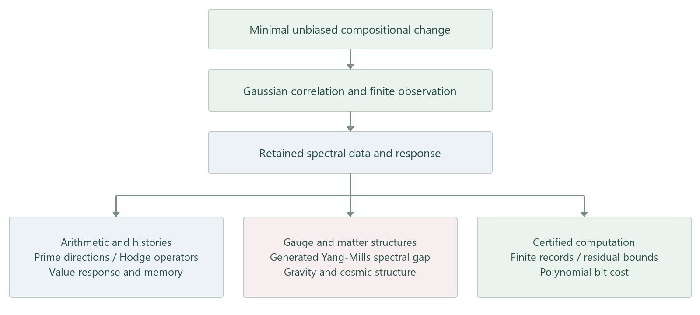

# Foundations from Minimal Change

## Books, mathematics, physics and computation

Research papers and books by **Jinku Guo**, Northwestern Polytechnical University.

[The book](books/beyond-apparent-paths/README.md) · [Research portal](https://bookwormseagull1980.github.io/Book-and-Articles/) · [Lean proofs](https://github.com/bookwormseagull1980/Lean-Formalization-of-Arithmetic-and-Basic-Physical-Interfaces) · [V5 calculations](https://github.com/bookwormseagull1980/coarse-graining-genesis) · [Research discussions](https://github.com/bookwormseagull1980/Book-and-Articles/discussions)

## The book

### Beyond Apparent Paths: The Practice of Seeking Truth from Facts

How do order, life, consciousness, society and meaning emerge from a world in
constant change? *Beyond Apparent Paths* develops the philosophical and
methodological perspective of this collection, bringing physics, biology,
neuroscience, complexity science, and Eastern and Western philosophy into a
multi-level account of reality.

The book follows the relations between disorder and possibility, symmetry and
emergence, evolution and self-organization. Its central concern is how we come
to understand and act in a changing world, by returning to facts and processes
and attending to the relations between different levels of organization.

The five-page English preview presents the title page, the note to the reader
and the complete contents of the 31-chapter book.

[Book description and contents](books/beyond-apparent-paths/README.md)
· [Read the English preview](https://raw.githubusercontent.com/bookwormseagull1980/Book-and-Articles/main/books/beyond-apparent-paths/Beyond%20Apparent%20Paths%20-%20Preview.pdf)

## The research programme

How much mathematical and physical structure can be generated from a common
description of change? This programme begins with minimal unbiased compositional
change, derives its Gaussian correlation law, and follows the structures retained
by finite observation. Its mathematical branch constructs arithmetic together
with the expressions that generate its elements. Its physical branch develops
compact spectral geometry, gauge and matter response, and macroscopic dynamics.
Its computational branch turns finite observations into independently checkable
records with explicit error and bit-cost bounds.

The common source matters. Changing a source input changes several sectors
together, so a coupling, mass response and cosmological readout can be compared
as related outputs of one construction. The papers develop these connections as
explicit maps, operators and compatibility theorems.

## Principal results

### Generated arithmetic and retained histories

The arithmetic construction starts from correlation geometry and an ordered
spectral family. Native modulation and composition define addition and
multiplication; winding degree certifies the resulting ordered Peano semiring.
Finite expression fibres retain input order, brackets and operation labels.
Different ways of producing the same value therefore remain distinguishable.
The history-assembly operator couples these differences back to observable
values: a history component with zero initial value readout can produce a
nonzero later readout. Eliminating the differences gives an exact memory equation.

[Arithmetic and histories](topics/generated-arithmetic.md)

### Prime directions and operator responses

Cascade-irreducible prime modes, their residue classes in the augmentation
cotangent space, and degree-one harmonic bar vectors are linked by explicit
identifications. The degree-one Hodge operator has eigenvalue `d(n)-2`, where
`d(n)` counts positive divisors; its heat flow localizes the prime sector with
sharp operator error `exp(-tau)`. Symmetric and graded exterior occupations
give zeta and reciprocal-zeta traces. Additive input spaces retain the relative
data required to intertwine addition with multiplicative central parity.

[Prime decomposition and operator methods](topics/prime-operators.md)

### Gauge structure and the generated Yang-Mills spectral gap

The compact internal construction produces gauge and matter structures in its
stated response classes, including the Standard Model gauge quotient and a
scalar weak doublet. A generated nonlinear action has a differentiated
original-field Hessian with radial and coexact connection sectors. Its unique
self-adjoint closure has an attained positive spectral bottom and the
corresponding finite-occupation Fock gap. These operator statements are
formalized in Lean. V5 supplies the finite spectral-response calculation and
the separately certified transverse-traceless endpoint realization.

[Gauge structure, matter and spectral gaps](topics/gauge-and-mass-gap.md)

### Emergent gravity and cosmic structure

A source-resolved spectral criterion identifies long-range tensor exchange.
Coarse-graining retains four response defects, including direct response and
hidden-state memory, rather than retaining a propagator alone. Moving spectral
windows carry reconstruction bounds and object moments into finite cosmological
calculations. A continuous-trajectory certificate covers a 4,096-particle example
at its stated mesh resolution; cold-sheet evolution has a separate pre-crossing
certificate.

[Gravity, coarse-graining and cosmology](topics/gravity-and-cosmology.md)

### Certified computation and the P vs NP connection

Generated function classes carry finite construction certificates. Interaction
weights and full quadratic ledgers preserve the data used to control nonlinear
spectral approximations. For a specified semilinear Neumann evolution problem,
finite rational trajectory records have independently checked residuals and
polynomial bit cost. The computation paper also proves an equality of certified
relations and deterministic polynomial-time computation in its generated
framework, and identifies the uniform-generation condition that connects this
statement to the standard P vs NP problem.

[Generated computation and complexity](topics/certified-computation.md)

## Where to start

- **For the broader ideas:** begin with [Beyond Apparent Paths](books/beyond-apparent-paths/README.md).
  It develops the account of change, levels and understanding that gives the
  collection its philosophical and methodological setting.
- **For the construction:** read *A Spectral Construction of Natural-Number
  Arithmetic*, then *Prime Decomposition and Operator Responses*. Continue to
  the generated-spectrum and certified-computation papers for finite observation.
- **For physics:** start with *Compact Internal Space I*, then its numerical
  companion *II*. Read the gravity criterion and coarse-graining paper before
  *III*, which develops finite-window cosmic structure formation.
- **For verification:** start with the [Lean library](https://github.com/bookwormseagull1980/Lean-Formalization-of-Arithmetic-and-Basic-Physical-Interfaces)
  and its theorem-to-paper index, or the [V5 reviewer guide](https://github.com/bookwormseagull1980/coarse-graining-genesis/blob/master/REVIEWER_START_HERE.md)
  for computational records, interval enclosures and comparisons.

## Papers

Each title opens a substantial introduction, the reading PDF and its metadata.
Preprint links appear first, followed by the Zenodo archival record.

| Work | Paper links |
| --- | --- |
| [A Spectral Construction of Natural-Number Arithmetic](articles/a-spectral-construction-of-natural-number-arithmetic/README.md) | [SSRN](https://ssrn.com/abstract=7421398) · [Zenodo](https://doi.org/10.5281/zenodo.22512592) |
| [Prime Decomposition and Operator Responses in Spectral Natural-Number Arithmetic](articles/prime-decomposition-and-operator-responses-in-spectral-natural-number-arithmetic/README.md) | [SSRN](https://ssrn.com/abstract=7650278) · [Zenodo](https://doi.org/10.5281/zenodo.23538151) |
| [Dynamics of Generated Spectra from Minimal Change: Certified Function Classes and Finite Windows](articles/dynamics-of-generated-spectra-from-minimal-change/README.md) | [SSRN](https://ssrn.com/abstract=7649818) · [Zenodo](https://doi.org/10.5281/zenodo.23536976) |
| [Certified Spectral Computation for Semilinear Evolution: Finite Records and Polynomial Bit Cost](articles/certified-spectral-computation-for-semilinear-evolution/README.md) | [SSRN](https://ssrn.com/abstract=7659059) · [Zenodo](https://doi.org/10.5281/zenodo.23582642) |
| [A Spectral Criterion for Emergent Gravity](articles/a-spectral-criterion-for-emergent-gravity/README.md) | [arXiv](https://arxiv.org/abs/2607.21621) · [SSRN](https://ssrn.com/abstract=7352000) · [Zenodo](https://doi.org/10.5281/zenodo.22093341) |
| [Coarse-Graining and Long-Range Response in Generated Systems](articles/coarse-graining-and-long-range-response/README.md) | [arXiv](https://arxiv.org/abs/2608.01989) · [SSRN](https://ssrn.com/abstract=7352038) · [Zenodo](https://doi.org/10.5281/zenodo.22093524) |
| [The Spectrum of a Compact Internal Space I: Gauge Structure and a Scalar Mass Gap](articles/the-spectrum-of-a-compact-internal-space-i/README.md) | [SSRN](https://ssrn.com/abstract=7352020) · [Zenodo](https://doi.org/10.5281/zenodo.22067117) |
| [The Spectrum of a Compact Internal Space II: Effective Couplings and Mass Scales](articles/the-spectrum-of-a-compact-internal-space-ii/README.md) | [SSRN](https://ssrn.com/abstract=7351999) · [Zenodo](https://doi.org/10.5281/zenodo.22067468) |
| [The Spectrum of a Compact Internal Space III: Finite-Window Dynamics of Cosmic Structure Formation](articles/the-spectrum-of-a-compact-internal-space-iii/README.md) | [SSRN](https://ssrn.com/abstract=7659840) · [Zenodo](https://doi.org/10.5281/zenodo.23583996) |

## Citation and contact

Use the individual work's citation record when referring to a result. The
collection itself has no single publication DOI. [Citation guidance](CITATION.md)
links the paper records, the Lean proof library and the computational framework.

Author: Jinku Guo · [ORCID 0009-0000-6600-6171](https://orcid.org/0009-0000-6600-6171)
· [guojk@nwpu.edu.cn](mailto:guojk@nwpu.edu.cn).
Questions about a mathematical statement, physical construction or numerical
record have three entry points in Discussions.

- [Research guide](https://github.com/bookwormseagull1980/Book-and-Articles/discussions/1)
- [Mathematics and physics Q&A](https://github.com/bookwormseagull1980/Book-and-Articles/discussions/new?category=q-a)
- [Proofs, calculations and reproduction help](https://github.com/bookwormseagull1980/Book-and-Articles/discussions/new?category=general)

Specific corrections can be submitted through [Issues](https://github.com/bookwormseagull1980/Book-and-Articles/issues/new/choose).

PDFs, source supplements and their rights are recorded separately in each work's
`metadata/RIGHTS.md`. LaTeX manuscript sources are not distributed here. Existing
immutable title tags and per-work checksums preserve earlier repository records.

Copyright (c) 2026 Jinku Guo.
