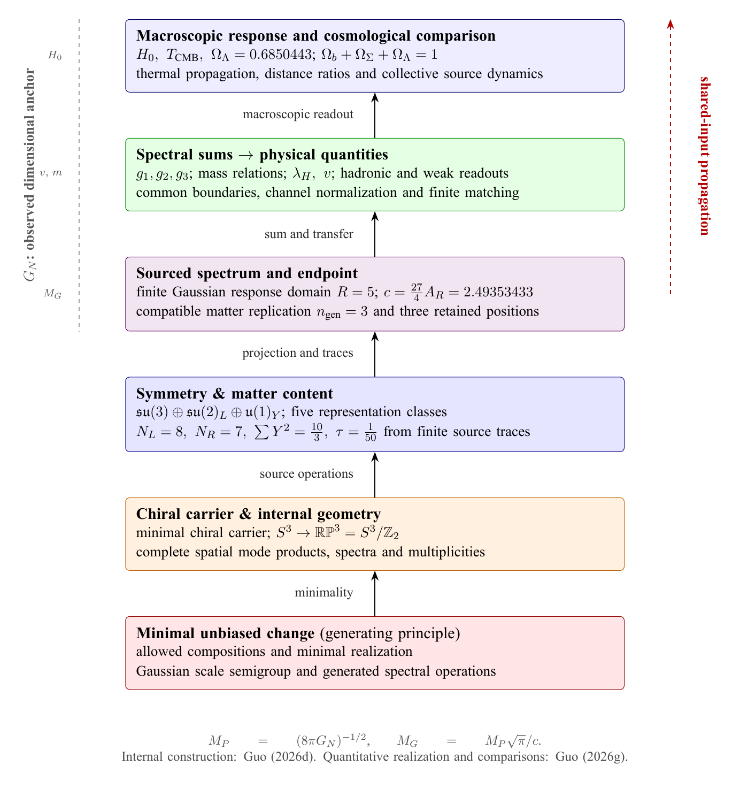

# Generated Gauge Structure and the Yang-Mills Spectral Gap

The physical construction follows a common source into compact internal
geometry, response algebras, matter representations and a nonlinear field
action. Keeping these stages connected allows the same source quantities to
enter both structural theorems and numerical readouts.

## Geometry, gauge structure and matter

The Gaussian correlation construction supplies local and global correlation
lengths and a reflected spectrum. In the stated compact representation and
response classes, the continuation selects the projective internal carrier,
the gauge quotient (SU(3) x SU(2) x U(1))/Z6, a sixteen-dimensional complex
matter bundle and a scalar weak doublet. The papers state the comparison
classes in which the corresponding selection and uniqueness results hold.

The upper row follows the structural construction; the lower row follows the
shared quantitative inputs into effective and macroscopic response.
[Open the vector diagram](../site/assets/physical-derivation.pdf).

## A nonlinear action and its complete Hessian

The generated Yang-Mills construction evaluates an actual curvature-trace
action on the original Haar one-form fields. Differentiating it gives the
radial response and the coexact connection block, with zero mixed second
derivative. The weak divergence kernel has a complete source-derived basis.
The original-field differential Hessian has a unique self-adjoint closure,
an explicit weighted-square domain and an attained positive spectral bottom.
Finite occupation then yields the associated Fock gap.

The Lean entry `CanonicalYangMills.generated` assembles the source-generated
IR-edge model. Its radius is the Gaussian IR edge. The separate
`CanonicalYangMillsTT.generated` uses a transverse-traceless endpoint
certificate. These two radius realizations have distinct formal interfaces
and numerical calibrations.

## Couplings and mass scales from a common response

V5 evaluates the finite spectral response and certifies its selected level and
endpoint. At the selected level R=5, an exact eight-branch reduction determines
a unique transverse-traceless endpoint near 2.49353433. The same generated
record feeds gauge couplings, mass-scale relations, electroweak matching and
cosmological readouts. Source-derived quantities, dimensional calibration and
observational comparisons remain separately inspectable.

The mass-relation paper develops one charged-lepton relation in a geometric
six-fermion setting. The numerical framework records which quantities are
derived, which are reference inputs, and which errors belong to finite
resolution or physical matching. A shared input can therefore be varied once
and its correlated effect followed across several observables.

The layered view separates the common structural source, its finite response
and physical readout. The observed Newton constant calibrates dimensions;
shared spectral inputs propagate through the upper layers.
[Open the vector diagram](../site/assets/physical-layers.pdf).

## Read and reproduce

- [Compact Internal Space I: Gauge Structure and a Scalar Mass Gap](../articles/the-spectrum-of-a-compact-internal-space-i/README.md)
- [Compact Internal Space II: Effective Couplings and Mass Scales](../articles/the-spectrum-of-a-compact-internal-space-ii/README.md)
- [Lean theorem library](https://github.com/bookwormseagull1980/Lean-Formalization-of-Arithmetic-and-Basic-Physical-Interfaces)
- [V5 calculations and interval certificates](https://github.com/bookwormseagull1980/coarse-graining-genesis)

Keywords: Yang-Mills, mass gap, spectral gap, gauge theory, Standard Model,
matter representations, Higgs doublet, compact internal geometry, Lean.
