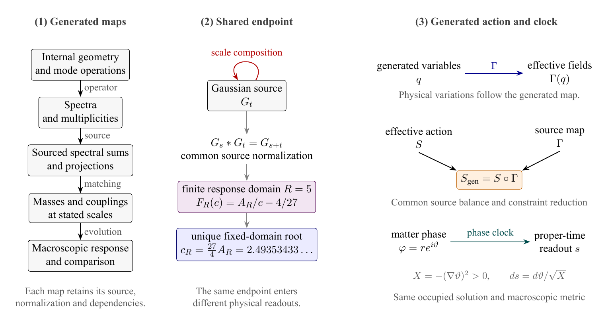

# Emergent Gravity and Cosmic Structure

An effective gravitational description must explain how sources couple to a
long-range response and how this response survives changes in resolution.
The papers approach these two questions before developing finite-window
cosmological dynamics.

## A source-resolved gravity criterion

The spectral criterion studies tensor exchange with a positive spectral
measure. A zero-mass spectral atom supplies the long-range pole, while the
source couplings and residue determine its observable strength. The full Schur
response retains the direct source term as well as the propagated term.
The construction connects the total source, including binding contributions,
to a universal inverse-distance response and states the conditions for an
Einstein completion.

## What coarse-graining must retain

A quotient that preserves an observable response need not preserve a
propagator alone. The coarse-graining paper derives exact updates for four
response defects, including source, readout and direct-response data. Hidden
initial conditions produce memory. This accounting gives criteria for the
stability of visible poles and residues as resolution changes.

The generated-action diagram follows source dependencies into physical
variations. The effective action is pulled back along the generated field map;
the phase clock is read from the occupied matter solution.
[Open the vector diagram](../site/assets/generated-action.pdf).

## Moving windows and cosmic structure

The finite-window dynamics paper retains the derivative of a moving spectral
projector. Reconstruction estimates track the discarded field, its return
through memory and the object moments retained by the observation map.
Cloud-in-cell moment data supply exact source information at the stated
resolution.

Computational examples include a continuous-trajectory certificate for 4,096
particles, with a bound below 0.286 percent of one mesh cell in that example,
and a separate cold-sheet certificate before first crossing. The V5
cosmological record also propagates the common spectral inputs into expansion
and structure observables. Finite certificates and comparisons with measured
data have separate records, so their conclusions can be assessed at the
resolution actually computed.

## Read

- [A Spectral Criterion for Emergent Gravity](../articles/a-spectral-criterion-for-emergent-gravity/README.md)
- [Coarse-Graining and Long-Range Response in Generated Systems](../articles/coarse-graining-and-long-range-response/README.md)
- [Compact Internal Space III: Finite-Window Dynamics of Cosmic Structure Formation](../articles/the-spectrum-of-a-compact-internal-space-iii/README.md)
- [V5 computational framework](https://github.com/bookwormseagull1980/coarse-graining-genesis)

Keywords: emergent gravity, spectral measures, Schur complement, coarse-graining,
memory kernels, cosmology, structure formation, finite-window dynamics.

## Research subjects and results

### Primary subjects

Emergent gravity; Massless spin-2 fields; Gravitational interaction; Universal gravitational coupling; Newtonian limit; Spectral representation; Stress-energy tensor; Källén-Lehmann representation; Effective field theory of gravity; Long-range interactions; Graviton exchange; Positive spectral measures; Coarse-graining; Model reduction; Linear response theory; Non-Markovian dynamics; Memory kernels; Effective dynamics; Resolvent estimates; Schur complements; Spectral approximation; Error bounds; Pole stability; Cosmic structure formation; Large-scale structure of the Universe; Cosmological simulations; N-body simulations; Gravitational clustering; Cosmological perturbation theory; Adaptive spectral methods; A posteriori error estimates; Validated numerics; Memory effects; Particle-mesh methods.

### Methods

Spectral theory; Operator theory; Analytic Fredholm theory; Schur complements; Resolvent estimates; Pole residues; Spectral projections; Contour integration; Finite-rank approximation; Operator convergence; Channel elimination; Positive measures; Linear response theory; Effective field theory; Spectral approximation; Projection methods; Operator approximation; Perturbation theory; Resolvent identities; Contour estimates; Block operator matrices; Common-space reconstruction; Differentiable factorization; Defect estimates; Operator norm bounds; Spectral projection; Matrix-valued response; Finite-memory approximation; Spectral Galerkin methods; Fourier methods; Dynamical coarse-graining; Memory truncation; Residual estimates; Stability estimates; Moment methods; Force error bounds; Trajectory enclosures; Interval bounds; Adaptive resolution; Observation error control; Moving-window analysis; Computational work accounting.

### Results and research questions

Spectral criterion for emergent gravity; Universal coupling from conserved matter sources; Newtonian potential from tensor exchange; Massless spectral atoms at continuum thresholds; Two-helicity long-range gravitational response; Finite-size bounds for gravitational exchange; Stability of critical pole residues under approximation; Vanishing transverse-traceless atomic weight for a positive conserved stress tensor; Response-preserving coarse-graining; Exact error identity for reduced response; Pole and residue stability under model reduction; Geometric convergence with memory length; Positive finite-rank response residues; Source overlap and observable critical modes; Conditions for memoryless reduced dynamics; Identification of response residues with massless spectral atoms; Certified cosmic structure formation dynamics; Continuous-time enclosures for cosmological particle trajectories; Least certified spectral window at a prescribed accuracy; Exact eight-moment cloud-in-cell representation; Force error bounds for reduced matter objects; Controlled re-entry of unresolved degrees of freedom; Full-frequency force bounds for cold-sheet evolution; Error-controlled reduction with verification cost included.

### Chinese subject terms

涌现引力; 无质量自旋二场; 引力子交换; 普适引力耦合; 牛顿极限; 引力有效场论; 能动张量; 正谱测度; 无质量谱原子; 长程张量相互作用; 普朗克尺度; 谱论; 粗粒化; 模型降阶; 线性响应; 非马尔可夫动力学; 记忆核; 长程响应; 极点稳定性; 留数误差; Schur补; 算子逼近; 约化动力学; 自由度消去; 宇宙结构形成; 宇宙大尺度结构; 宇宙学数值模拟; N体模拟; 引力聚集; 宇宙学微扰; 粒子网格方法; 自适应谱方法; 后验误差估计; 连续时间轨道认证; 冷物质动力学; 记忆效应.
